<div align="center">


# Kata

### Your agent repeats itself. Kata notices, and turns the repetition into a tool you approve.

Kata is a plugin for [Hermes Agent](https://github.com/NousResearch/hermes-agent). It watches the tool calls your agent
really makes, finds the multi-step routines it keeps rediscovering across conversations, and, **only after you review
and approve them**, compiles each one into a single deterministic tool. No model calls between steps. Every run traced.
Nothing activates without you.

<br>

[](https://github.com/opeblow/kata/actions/workflows/ci.yml)
[](tests)
[](.github/workflows/ci.yml)
[](#validated-in-real-hermes)
[](#validated-in-real-hermes)
[](pyproject.toml)
<br>
[](https://github.com/NousResearch/hermes-agent)
[](pyproject.toml)
[](.github/workflows/ci.yml)
[](#human-approval-is-not-optional)
<br>
[](LICENSE)
[](https://github.com/astral-sh/ruff)
[](CONTRIBUTING.md)
[](PRIVACY.md)

<br>

[**Demo video**](https://youtu.be/nMTOGmmoCq8) &nbsp;&middot;&nbsp; [**Website**](site/index.html) &nbsp;&middot;&nbsp; [**Documentation**](site/docs.html) &nbsp;&middot;&nbsp; [**Quick start**](#quick-start) &nbsp;&middot;&nbsp; [**Security**](SECURITY.md) &nbsp;&middot;&nbsp; [**Privacy**](PRIVACY.md)

<br><br>

<a href="https://youtu.be/nMTOGmmoCq8" title="Watch the Kata demo on YouTube">
  
</a>

<sub><b>Watch the 86-second demo.</b> Everything in it is real: Hermes sessions, the Kata dashboard and measured savings.</sub>

</div>

<br>

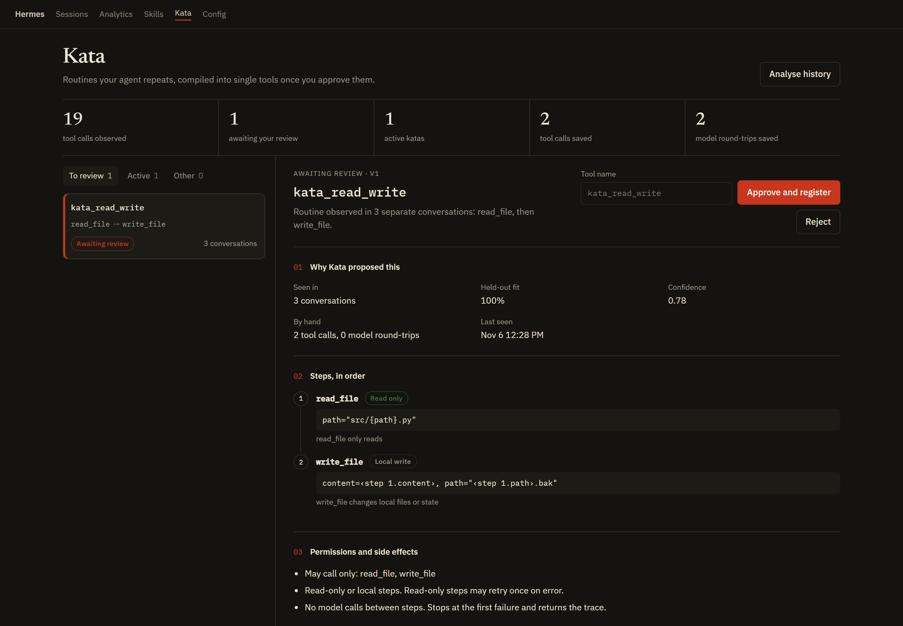

<p align="center"><sub>The Kata tab inside the Hermes dashboard. A routine Kata detected in the agent's own history, waiting for a human decision.</sub></p>

<br>

## Table of contents

- [The problem](#the-problem)
- [What Kata does](#what-kata-does)
- [Before and after](#before-and-after)
- [Why it stands out](#why-it-stands-out)
- [How it works](#how-it-works)
- [Human approval is not optional](#human-approval-is-not-optional)
- [Validation: twelve checks before anything runs](#validation-twelve-checks-before-anything-runs)
- [Safety model](#safety-model)
- [Validated in real Hermes](#validated-in-real-hermes)
  - [Verification summary: every test we ran](#verification-summary-every-test-we-ran)
  - [What real testing caught](#what-real-testing-caught)
- [Built for production](#built-for-production)
- [Quick start](#quick-start)
- [Verify it yourself in 30 seconds](#verify-it-yourself-in-30-seconds)
- [Screenshots](#screenshots)
- [Commands](#commands)
- [Configuration](#configuration)
- [Architecture](#architecture)
- [Project structure](#project-structure)
- [Development](#development)
- [FAQ](#faq)
- [Limitations](#limitations)
- [Roadmap](#roadmap)
- [Contributing](#contributing)
- [License](#license)

## The problem

Agents rediscover the same workflow every single time.

Hermes remembers facts and grows skills. But the fortieth time it searches for something, reads the hit and runs a check
on it, it still stops after **every** step to ask the model what to do next. Each of those pauses is a full model request
carrying the whole conversation. And nothing guarantees step three runs the same way it did last week.

That is three costs on every repeated task:

| Cost | Where it comes from |
|---|---|
| **Tokens** | Every intermediate step is a model request with the full context. |
| **Latency** | A three-step routine waits on the model twice before it can finish. |
| **Drift** | A prompt or skill *describes* the routine. Nothing makes the agent execute it identically. |

## What Kata does

```
observe  ──▶  discover  ──▶  validate  ──▶  ask you  ──▶  run as one tool
```

1. **Observe.** Records every tool call through Hermes's `post_tool_call` hook, with secrets masked before anything
   touches disk. Times every model request through `post_api_request`.
2. **Discover.** Finds routines that recur across separate conversations, and works out which arguments are fixed,
   which are inputs, and which flow from an earlier step's result.
3. **Validate.** Proves each candidate offline against recorded history with twelve checks. Rejects anything unsafe or
   unreliable.
4. **Ask.** Shows you exactly what would run, why it was detected, what it may touch, and its side effects. Nothing is
   registered until you approve it.
5. **Run.** The approved routine becomes a real Hermes tool the agent calls once. Same calls, same order, same
   arguments. Stops at the first failure with a full trace.

## Before and after

One real routine, from the reproducible run in [`docs/demo-output.txt`](docs/demo-output.txt):

<table>
<tr><th width="50%">Before: the agent, by hand, every time</th><th width="50%">After: one approved tool</th></tr>
<tr><td>

```text
model   → decide to search
tool    search_files(pattern="TODO(erin)", path="src")
model   → decide to read the hit
tool    read_file(path="src/billing_erin.py")
model   → decide to count lines
tool    terminal(command="wc -l src/billing_erin.py")
model   → answer
```

</td><td>

```text
model   → call the kata
tool    kata_triage_todo(pattern="erin")
          1 search_files   ok
          2 read_file      ok   path ← step 1
          3 terminal       ok   path ← step 2
model   → answer
```

</td></tr>
</table>

| Per run | By hand | With Kata |
|---|:---:|:---:|
| Tool calls the model has to make | 3 | **1** |
| Model requests in the turn | 4 | **2** |
| Steps actually executed | 3 | 3 |
| Same arguments every time | not guaranteed | **guaranteed** |

Tool calls and model requests are counted. Token and latency savings depend on your model and context size; Kata
measures them on your machine from `post_api_request` and reports them in the dashboard. We do not publish projections.

## Why it stands out

| | Prompt or skill | Workflow recorder | **Kata** |
|---|---|---|---|
| Where the routine comes from | Someone writes it | One demonstration you perform | **The agent's own repeated, successful behaviour** |
| Evidence that it generalises | None | None | **Leave-one-out fit across separate conversations** |
| Execution | Model re-plans every step | Model replays a description | **Deterministic, zero model calls between steps** |
| Data flow between steps | Implicit | Implicit | **Explicit, e.g. `<step 1.matches.0.path>`** |
| Side effects | Up to the model | Up to the model | **Classified per step; external steps ask on every call, never retried** |
| When a tool changes | Silently breaks | Silently breaks | **Schema fingerprint marks it stale and unregisters it** |
| Audit trail | No | No | **Every version, run and decision recorded** |

Hermes judges plugins that do more than a prompt or a skill could. Kata changes the agent's **toolset** from evidence:
it registers tools, gates them with `pre_tool_call`, measures them with `post_api_request`, and executes through
`dispatch_tool`. A prompt cannot do any of that.

## How it works

```
 Hermes                         Kata                                                 Hermes
 ──────                         ────                                                 ──────
 post_tool_call   ──┐
                    ├──▶ Recorder ──▶ SQLite ──▶ Miner ──▶ Validator ──▶ Candidate
 post_api_request ──┘    (redacts)               │          12 checks       │
                                                 │                          ▼
                                          drift detection        You approve  (/kata · dashboard)
                                                                            │
                                                                            ▼
                                       Runtime ── register_tool ─────▶ kata_<name> in the agent's toolset
                                          │                                 │
                            pre_tool_call │ asks you if external            │ agent calls it once
                                          ▼                                 ▼
                                       Executor ── dispatch_tool ──▶ step 1 ▸ step 2 ▸ step 3
```

### Discovery that ignores coincidences

- **Segmentation.** Only contiguous, successful calls inside **one user turn** form a run. Failures, pauses over five
  minutes and conversational tools such as `clarify` break it. Unrelated requests are never glued together.
- **Support.** Every window of 2 to 8 calls is keyed by tool names plus argument keys, counted once per turn, and must
  recur in at least **three separate conversations**. Repeating something ten times in one chat proves nothing.
- **Maximality.** A window contained in an equally frequent longer window is dropped, so Kata proposes whole routines,
  not fragments.
- **Coherence.** Every step after the first must be tied to the routine by data flow or a fixed argument. Random
  sequences that recur by chance are rejected. On 19,256 events of mixed history, Kata finds the one real routine and
  proposes nothing else (see [`tests/test_scale.py`](tests/test_scale.py)).

### Generalisation

| Observed across runs | Becomes | Example |
|---|---|---|
| Same value every time | Constant | `path="src"` |
| Equals a field of an earlier result | Reference | `<step 1.matches.0.path>` |
| Contains an earlier result | Template with a reference | `"wc -l <step 2.path>"` |
| Changes and cannot be derived | Input parameter | `"TODO({pattern})"` |

### Confidence

For each occurrence, a template is built from **all the others** and must reproduce the held-out one exactly. The share
that pass is the fit rate. `confidence = fit_rate × (1 − 0.6^support)`: 0.78 at three conversations with a perfect fit,
0.87 at four. The default threshold is 0.75.

## Human approval is not optional

Observed behaviour **never** becomes an active tool on its own. Before registration you see:

- **What it does** and the exact steps, in order, with every argument as a template.
- **Why it was detected:** number of conversations, held-out fit, confidence, and the measured cost of doing it by hand.
- **Permissions:** the only tools it may call, and the highest effect level.
- **Input and output schemas.**
- **Side effects,** per step, with the reason for each classification.
- **The validation report.**

Approve from `/kata approve`, `hermes kata approve`, or the dashboard. Approval re-runs validation and is written to the
audit log with its actor. Rejections are final: a rejected routine is never proposed again.

## Validation: twelve checks before anything runs

Validation runs when a proposal is created and again at approval. **No real tool is called.** The executor runs against
a stub dispatcher that replays recorded results.

| Check | What it proves |
|---|---|
| `replay_matches_recorded` | Inputs recovered from each recorded example re-render its exact arguments |
| `holdout_fit` | The template reproduces examples it was not built from (at least 90%) |
| `executor_replay` | The compiled path issues the recorded calls, in order, call for call |
| `failure_handling` | An injected error stops the run; every later step is skipped |
| `timeout_handling` | A hung step times out, is never re-issued, and stops the run |
| `input_schema` | The schema accepts every recorded input and rejects an incomplete call |
| `output_schema` | Every recorded final result matches the output schema |
| `no_secrets` | No credential or redacted value is embedded anywhere |
| `tools_available` | Every tool exists today with the schema it had when recorded |
| `compilable_tools` | No conversational or self-referential tools |
| `recorded_examples` | Enough real examples exist to prove the above |
| `side_effects` | Effects are disclosed and the per-call approval rule is set |

## Safety model

| Guarantee | How |
|---|---|
| **No tool without consent** | Only `approve` can activate a kata, and it re-validates first. Every transition is audited. |
| **No silent side effects** | Katas with external or unknown steps return an `approve` directive from `pre_tool_call` on **every** call, with a fresh rule key so a remembered approval cannot repeat them. Unattended runs follow Hermes's approval policy. |
| **No repeated side effects** | Only read-only steps are retried. A timed-out step is never re-issued. |
| **Least privilege** | A kata can only dispatch the tools in its own approved steps, through Hermes's dispatcher. |
| **Allowlist classification** | Shell commands are classified by an allowlist (`git status` is read, `git commit` is local write). Anything unrecognised is treated as external. Kata never tries to guess what is safe. |
| **No secrets in tools** | Arguments and results are redacted at record time. A routine whose fixed arguments contain a secret is rejected. |
| **Drift aware** | Tool schemas are fingerprinted at approval. A changed or missing tool marks the kata stale and unregisters it. Three consecutive failures suspend it. If your manual runs stop fitting the template, Kata prepares a revised version for review. |
| **Local only** | No network requests, no telemetry. One SQLite file in your Hermes profile. |

Read the full threat model in [SECURITY.md](SECURITY.md) and data handling in [PRIVACY.md](PRIVACY.md).

## Validated in real Hermes

Kata was installed from this repository into **Hermes Agent v0.23.0** on Windows and exercised with a real model, the
same way a user would run it. Everything below is unedited output from that machine (only the local folder path is
shortened to `./kata`). The raw text is in [`docs/real-hermes/`](docs/real-hermes).

### Verification summary: every test we ran

| # | What was tested | How | Result | Evidence |
|---|---|---|---|---|
| 1 | Hermes version | `hermes --version` | **Hermes Agent v0.23.0** (stable) | [`version.txt`](docs/real-hermes/version.txt) |
| 2 | Hermes's own catalog checks | `hermes plugins validate ./kata` | **15 / 15 checks passed**, security scan **safe**, no core override | [`validate.txt`](docs/real-hermes/validate.txt) |
| 3 | Plugin loads in Hermes | `hermes plugins doctor ./kata --ci` | **OK**: discovery, import and registration (1 tool, 6 hooks) | [`doctor.txt`](docs/real-hermes/doctor.txt) |
| 4 | Learns from real use | The agent did one task by hand in **3 separate sessions**, then `hermes kata review 1` | Routine detected, input and data flow inferred, **12 / 12 validation checks passed** | [`review.txt`](docs/real-hermes/review.txt) |
| 5 | Approval registers the tool | `hermes kata approve 1 as triage_todo` | `kata_triage_todo` **active (v3)** | [`list.txt`](docs/real-hermes/list.txt) |
| 6 | The learned tool does the job | New session with claude-sonnet-5-5, same request | **1 tool call** instead of 3, correct answer, 12.5 s total | [`session.txt`](docs/real-hermes/session.txt) |
| 7 | It works every time | `/kata runs kata_triage_todo` | **3 successful runs in a row**, all 3 steps ok, ~5.6 s each | [`runs.txt`](docs/real-hermes/runs.txt) |
| 8 | Failure is handled safely | A run with a bad input (before the fix below) | Stopped at the failing step, skipped the rest, returned control to the agent | [`runs.txt`](docs/real-hermes/runs.txt) (10:08 row) |
| 9 | Savings are measured | `hermes kata stats` | **6 tool calls, 6 model round-trips and 74,739 tokens saved** | [`stats.txt`](docs/real-hermes/stats.txt) |
| 10 | Automated test suite | `pytest` with coverage, `ruff check` | **50 tests passing**, 89% coverage, lint clean | [`tests/`](tests) |
| 11 | Cross-platform CI | GitHub Actions | Linux, macOS and Windows on Python 3.11, 3.12 and 3.13 | [`ci.yml`](.github/workflows/ci.yml) |
| 12 | End-to-end demo without a model | `python scripts/demo.py` | Learns, proposes, approves and runs the tool | [`demo-output.txt`](docs/demo-output.txt) |
| 13 | Demo video | Recorded from the runs above | Real sessions, real dashboard, real numbers | [YouTube](https://youtu.be/nMTOGmmoCq8) |

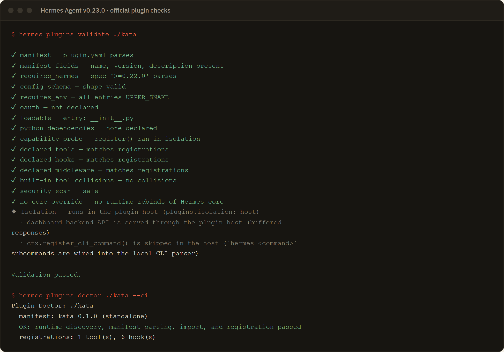

<p align="center"><sub><b>Hermes's own catalog checks.</b> <code>hermes plugins validate</code> passes every check, including the install-time security scan (<b>safe</b>) and the no-core-override check. <code>hermes plugins doctor</code> passes discovery, import and registration.</sub></p>

<br>

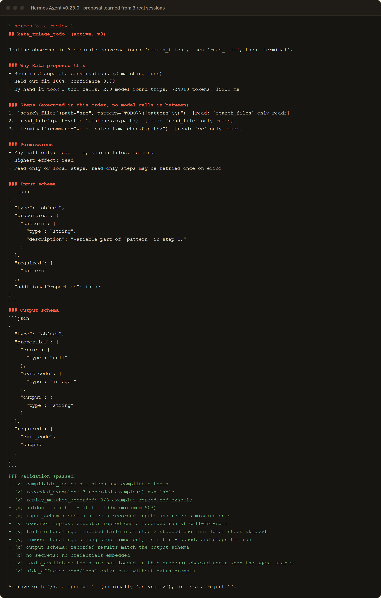

<p align="center"><sub><b>A tool learned from three real agent sessions.</b> The agent triaged a TODO by hand three times. Kata detected the routine, inferred the input (<code>pattern</code>) and the data flow (the file path comes from step 1's result), passed all twelve checks, and measured the real cost of doing it by hand: <b>~24,900 tokens and ~15 seconds</b> of model work per run.</sub></p>

<br>

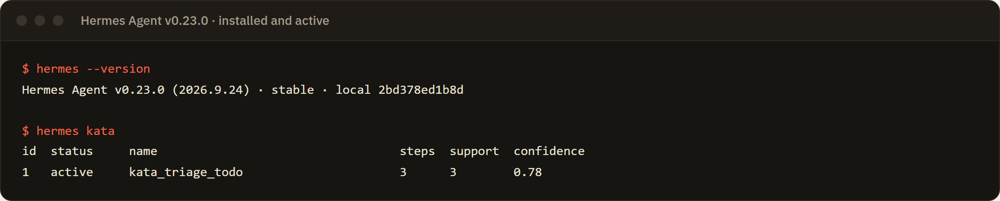

<p align="center"><sub><b>Approved and active.</b> After <code>hermes kata approve 1 as triage_todo</code>, the tool is registered in new Hermes sessions (Hermes's log: <code>kata: registered kata_triage_todo</code>).</sub></p>

<br>

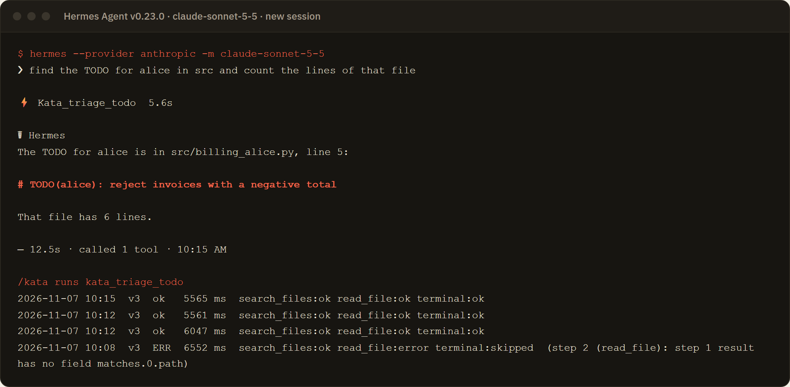

<p align="center"><sub><b>The learned tool doing the job in a new session.</b> Same request, now answered with <b>one tool call</b> (<code>kata_triage_todo</code>, 5.6 s) instead of three model round trips. <code>/kata runs</code> shows every step of three consecutive successful runs. The failed run at the bottom is the input bug listed below, kept unedited: Kata stopped at the failing step, skipped the rest and handed control back to the agent.</sub></p>

<br>

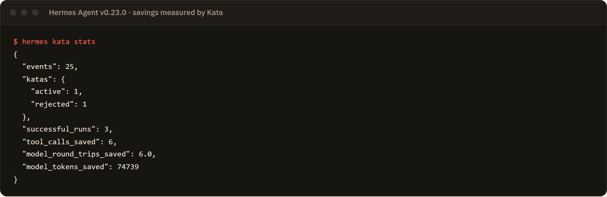

<p align="center"><sub><b>Savings measured, not estimated.</b> After three real runs: <b>6 tool calls</b>, <b>6 model round trips</b> and <b>74,739 model tokens</b> saved, from Kata's own measurements of doing the task by hand.</sub></p>

### What real testing caught

Running against a real Hermes and a real model exposed problems no simulation did. Each was fixed, given a regression
test built from the recorded data, and re-verified in Hermes:

| Found in real use | Fix |
|---|---|
| On Windows, `search_files` returns `src\file.py` while the model sometimes writes `src/file.py`, hiding the data flow | Values match across path separators; replays use the form the agent wrote |
| The model searched with a regex-escaped pattern, `TODO\(alice\)`, and the escape leaked into the learned input | Escape characters are treated as fixed structure, so the input is exactly `alice` |
| Loading the plugin held its database open, which failed `plugins doctor` on Windows | The database opens on first use and is released after loading |
| `hermes kata approve` runs where Hermes's tools are not loaded, so tools looked missing | Tool checks are deferred to the agent process, which records tool schemas on start |
| Background mining ran while another conversation was mid-routine and proposed a fragment | Only finished turns are mined |
| A `chr()` string helper made the security scan report **caution** | Replaced with plain strings; a test now forbids it |
| Hermes 0.23 hides plugin tools behind `tool_search`, so the model did the task by hand instead of loading the kata | The routines prompt tells the agent to load the kata first; for best results set `tools.tool_search.enabled: "off"` (see Quick start) |
| With no example in its input schema, the model passed a whole regex (`TODO.*alice\|alice.*TODO`) where the kata wanted `alice` | The input schema now shows recorded values (`"alice"`, `"bob"`, `"carol"`), and the agent passes just the value |

When a compiled run hit the escaping bug in a live session, Kata stopped at the failing step, skipped the rest, recorded
the error, and returned control to the agent: the safety path worked as designed before the root cause was fixed.

## Built for production

| | |
|---|---|
| **Verified against Hermes source** | Every hook, context method and payload field Kata uses was checked in the `hermes-agent` source, and every Hermes import is on its public plugin API list. No invented APIs. |
| **Passes catalog admission** | [`tests/test_admission.py`](tests/test_admission.py) mirrors the catalog rules: manifest fields, declared versus registered tools and hooks, valid hook names, `**kwargs` on every callback, public imports only, no core rebinds, no compiled artifacts. |
| **Clean security scan** | Hermes's install-time scanner patterns report **zero** findings on the plugin directory. |
| **Fast at scale** | Mining 19,256 events takes about 3.5 seconds on a laptop and finds only the real routine. History is bounded by retention and a 50,000-event window. |
| **Multi-process safe** | WAL-mode SQLite with a busy timeout. Tool calls and model requests share one sequence, so savings are attributed correctly even where the system clock is coarse. Dashboard approvals reach the agent process through a generation counter checked once per turn. |
| **Upgradable** | Versioned database schema with forward-only migrations. A newer database is refused rather than corrupted. |
| **Retention-aware** | Old history is pruned, but events that back an existing kata's evidence are kept so it can always be re-validated. |
| **Cross-platform** | CI runs on Linux, macOS and Windows with Python 3.11, 3.12 and 3.13, plus the full end-to-end run. |
| **Zero dependencies** | Standard library only at runtime. |

## Quick start

Requires Hermes Agent 0.22.0 or newer.

```bash
hermes plugins install kata
hermes plugins enable kata
```

Start a new session and work normally. Kata stays silent until a routine has repeated in three separate
conversations, then proposes it when the session ends.

```text
/kata                              what Kata has found
/kata review 1                     steps, data flow, permissions, schemas, side effects, validation
/kata approve 1 as triage_todo     registers kata_triage_todo
```

Hermes builds each session's tool list when the session starts, so the agent can call a newly approved kata from your
next session. You can also open the **Kata** tab in `hermes dashboard`.

Hermes 0.23 hides plugin tools behind `tool_search` by default, and models often skip loading them for short tasks. To
keep approved katas directly callable, add this to your Hermes `config.yaml` and restart Hermes (and the gateway, if it
is running, with `hermes gateway restart`):

```yaml
tools:
  tool_search:
    enabled: "off"
```

To install from source at a pinned commit before the catalog listing is merged:

```bash
hermes plugins install "opeblow/kata#kata" --ref <40-character-commit-sha>
```

## Verify it yourself in 30 seconds

No model, no API key, no Hermes install needed:

```bash
git clone https://github.com/opeblow/kata && cd kata
python scripts/demo.py
```

This drives the real plugin through [`devtools/fake_hermes.py`](devtools/fake_hermes.py), a host that fires the same
hooks with the same payload fields as Hermes and runs real tools on a scratch repository. It records four manual runs,
detects the routine, prints the proposal card, approves it, runs the compiled tool in a new conversation, and prints the
measured difference. Full output: [`docs/demo-output.txt`](docs/demo-output.txt).

## Screenshots

<table>
<tr>
<td width="50%">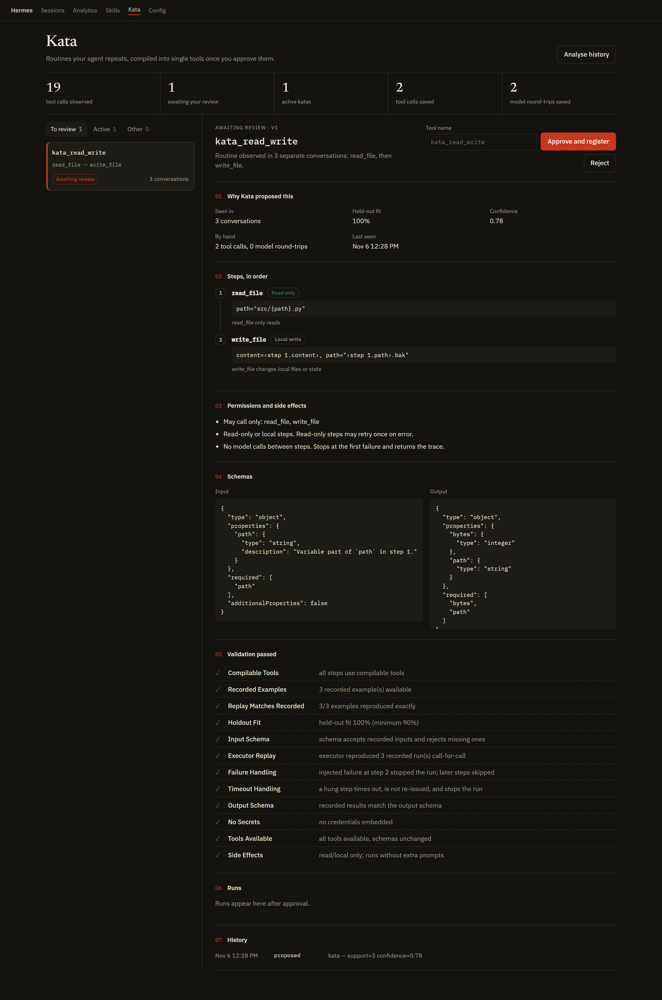</td>
<td width="50%">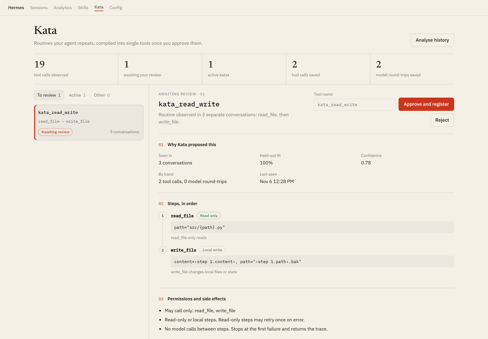</td>
</tr>
<tr>
<td><b>An active kata.</b> The twelve-check validation report, every run with per-step status and timing, and the audit history of who approved what and when.</td>
<td><b>Light theme.</b> The tab inherits the host dashboard's theme. Hairlines and fills derive from the text colour, so it reads correctly on any Hermes theme.</td>
</tr>
<tr>
<td>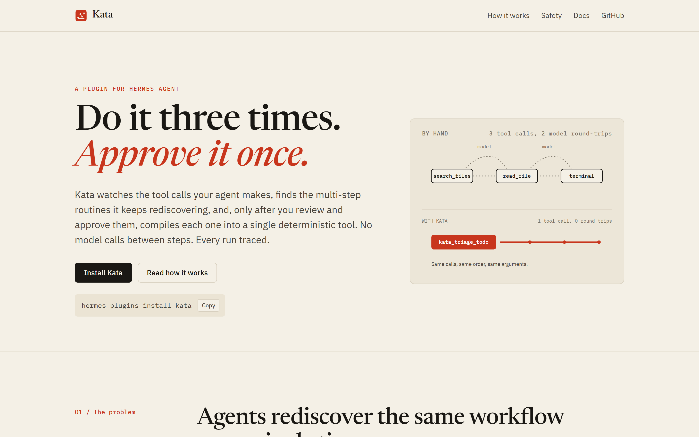</td>
<td>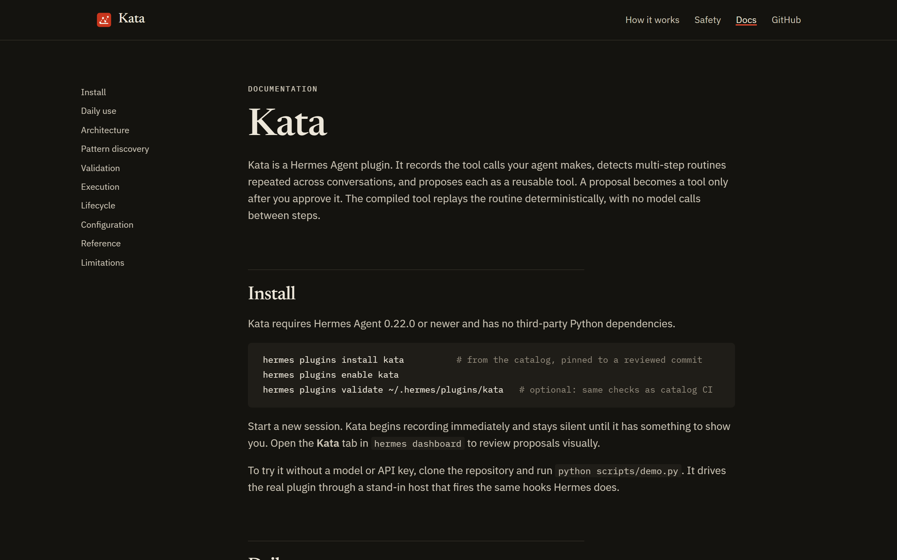</td>
</tr>
<tr>
<td><b>Website.</b> The hero diagram is the product in one picture: three calls with two model round-trips collapse into one stroke.</td>
<td><b>Documentation.</b> Install, daily use, architecture, discovery, validation, execution, lifecycle, configuration and limits.</td>
</tr>
<tr>
<td align="center">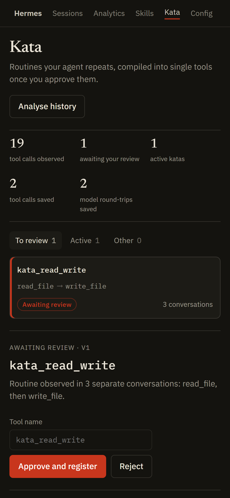</td>
<td align="center">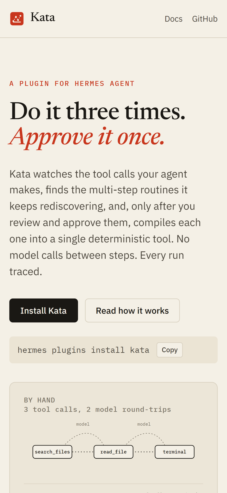</td>
</tr>
<tr>
<td><b>Dashboard at phone width.</b> One column, same actions, same information.</td>
<td><b>Website at phone width.</b> Designed for small screens, not shrunk to fit them.</td>
</tr>
</table>

## Commands

| Command | What it does |
|---|---|
| `/kata` | List proposals, active, stale and suspended katas |
| `/kata review <id\|name>` | The full proposal card |
| `/kata approve <id> [as <name>]` | Re-validate, then register as `kata_<name>` |
| `/kata reject <id> [reason]` | Decline. The routine is never proposed again |
| `/kata disable <name>` | Unregister immediately |
| `/kata enable <name>` | Re-validate and re-register |
| `/kata rollback <name> [version]` | Switch to an earlier approved version |
| `/kata runs <name>` | Recent executions with per-step status |
| `/kata mine` | Analyse history now instead of at session end |
| `/kata stats` | Tool calls, model round-trips and tokens saved |

Every subcommand also works from a shell as `hermes kata ...`. The agent can call `kata_list` to see what is available
and what is pending.

When a compiled tool fails, it stops at the failing step, skips the rest, and returns the trace with a hint to continue
by hand from that exact step. The agent never loses its place.

## Configuration

Under `plugins.entries.kata.settings` in Hermes's config (also rendered as a form in Hermes Desktop):

| Key | Default | Effect |
|---|---|---|
| `min_support` | `3` | Distinct conversations before a routine is proposed |
| `min_confidence` | `0.75` | Proposal threshold |
| `max_steps` | `8` | Longest routine considered |
| `step_timeout_s` | `60` | Per-step timeout, in seconds |
| `read_retries` | `1` | Retries for read-only steps (side-effecting steps never retry) |
| `retention_days` | `30` | Days of history kept for mining |
| `record` | `true` | Pause or resume observation |

## Architecture

| Module | Responsibility |
|---|---|
| [`runtime.py`](kata/runtime.py) | Hook handlers, tool registration and disposal, the compiled-tool handler, per-call approval |
| [`miner.py`](kata/miner.py) | Segmentation, windowed counting, maximality, coherence, leave-one-out scoring, baselines |
| [`templating.py`](kata/templating.py) | Argument inference, rendering, and matching (the inverse of rendering) |
| [`validator.py`](kata/validator.py) | The twelve offline checks, with a replaying stub dispatcher |
| [`executor.py`](kata/executor.py) | Deterministic execution with timeouts, bounded retries and traces |
| [`service.py`](kata/service.py) | Lifecycle rules shared by `/kata`, the CLI and the dashboard |
| [`effects.py`](kata/effects.py) | Allowlist side-effect classification for tools and shell commands |
| [`redact.py`](kata/redact.py) | Secret masking at record time |
| [`store.py`](kata/store.py) | Events, model requests, katas, versions, runs and audit; migrations and retention |
| [`dashboard/`](kata/dashboard) | Dashboard tab (React from the host SDK, no build step) and its FastAPI router |

**Hermes surfaces used.** Hooks `post_tool_call`, `post_api_request`, `pre_tool_call`, `pre_llm_call`,
`on_session_start`, `on_session_end`. Context methods `register_tool` (and its handle's `dispose`), `register_command`,
`register_cli_command`, `dispatch_tool`, `get_config`. Storage through `plugins.plugin_storage.plugin_db`. Drift detection
through `tools.registry.registry.get_schema`.

**Lifecycle.**

```
candidate ──approve──▶ active ──disable──▶ disabled ──enable──▶ active
    │                   │   │
  reject         schema │   │ 3 failed runs
    ▼            change ▼   ▼
 rejected            stale   suspended ──review, approve new version──▶ active
```

Every version is kept. Rollback switches to any earlier approved version after re-validating it.

## Project structure

```
kata/
├── .github/
│   ├── ISSUE_TEMPLATE/
│   │   ├── bug_report.yml
│   │   ├── config.yml
│   │   └── feature_request.yml
│   ├── workflows/
│   │   ├── ci.yml                    lint, manifests, tests on 3 OSes x 3 Pythons, coverage floor, end-to-end run
│   │   └── pages.yml                 publishes site/ to GitHub Pages
│   └── PULL_REQUEST_TEMPLATE.md
├── kata/                             the Hermes plugin (catalog subdir)
│   ├── dashboard/
│   │   ├── dist/
│   │   │   ├── index.js              dashboard tab
│   │   │   └── style.css
│   │   ├── manifest.json
│   │   └── plugin_api.py             FastAPI router behind the dashboard auth gate
│   ├── __init__.py                   register(ctx)
│   ├── card.py                       proposal card
│   ├── commands.py                   /kata and hermes kata
│   ├── effects.py                    side-effect classification
│   ├── executor.py                   deterministic execution
│   ├── miner.py                      pattern discovery
│   ├── models.py                     typed specs and expressions
│   ├── plugin.yaml                   manifest
│   ├── README.md
│   ├── redact.py                     secret masking
│   ├── runtime.py                    Hermes wiring
│   ├── service.py                    lifecycle
│   ├── store.py                      persistence and migrations
│   ├── templating.py                 inference, rendering, matching
│   └── validator.py                  pre-activation checks
├── devtools/
│   ├── fake_hermes.py                host with Hermes's hook contracts, for tests and verification
│   ├── preview_server.py             dashboard preview outside Hermes
│   └── screenshot.py                 Playwright screenshots
├── docs/
│   ├── assets/kata-mark.svg
│   ├── screenshots/
│   ├── catalog-entry.yaml            plugin-catalog/kata.yaml for the Hermes catalog
│   ├── demo-output.txt
│   ├── DESIGN-SYSTEM.md
│   └── SUBMISSION.md
├── scripts/
│   └── demo.py                       end-to-end verification run
├── site/                             website: index.html, docs.html, styles.css, main.js, favicon.svg
├── tests/
│   ├── conftest.py
│   ├── test_admission.py             catalog admission rules
│   ├── test_commands.py              /kata surface
│   ├── test_dashboard_api.py         cross-process approval through the dashboard
│   ├── test_end_to_end.py            full lifecycle, safety and drift
│   ├── test_scale.py                 19,256-event benchmark, no false positives
│   ├── test_store.py                 schema upgrades and request attribution by order
│   └── test_units.py                 templating, mining, effects, executor, validator
├── CODE_OF_CONDUCT.md
├── CONTRIBUTING.md
├── LICENSE
├── PRIVACY.md
├── pyproject.toml
├── README.md
└── SECURITY.md
```

## Development

```bash
python -m pip install -e ".[dev]"
python -m pytest --cov=kata          # 48 tests, 89% coverage
ruff check .
python scripts/demo.py --db /tmp/kata-demo.db
KATA_DB_PATH=/tmp/kata-demo.db python devtools/preview_server.py   # dashboard at http://127.0.0.1:8765
hermes plugins validate ./kata       # Hermes's own catalog checks
hermes plugins doctor ./kata --ci
```

The suite covers the full lifecycle (observe, propose, review, approve, run, measure), support thresholds,
same-conversation repetition, rejection finality, disable, enable and rollback, schema drift, runtime suspension,
argument validation, per-call approval that blocks side effects when denied, secret handling, workflow drift,
cross-process dashboard approval, catalog admission rules, and mining performance on 19,256 events.

## FAQ

<details>
<summary><b>Is this just a macro recorder?</b></summary>

No. A recorder replays one demonstration. Kata only proposes routines the agent performed successfully in several
separate conversations, proves the template generalises to runs it was not built from, works out data flow between
steps, classifies side effects, and asks before anything becomes a tool.
</details>

<details>
<summary><b>Could Kata turn something dangerous into a one-click tool?</b></summary>

Only what you approve, and only as safely as you did it by hand. Steps with external or unrecognised effects ask you on
every single call, are never retried, and are blocked in unattended runs unless Hermes's approval policy allows them.
</details>

<details>
<summary><b>What happens when my tools or habits change?</b></summary>

If a tool's schema changes, the kata is marked stale and unregistered before it can run. If your manual runs stop
fitting the template, Kata flags it and prepares a revised version for you to review. Old versions remain available
for rollback.
</details>

<details>
<summary><b>Does Kata send my data anywhere?</b></summary>

No. Kata makes no network requests and has no telemetry. Everything stays in one SQLite file in your Hermes profile. See
[PRIVACY.md](PRIVACY.md).
</details>

<details>
<summary><b>Does it add model calls?</b></summary>

No. Mining, validation and execution are deterministic and use no model.
</details>

## Limitations

- Kata compiles linear routines. Branching on a result ("if the tests fail, then...") stays with the agent.
- References resolve against JSON results. A value buried inside free-form text output becomes an input instead.
- A newly approved kata is registered immediately, and the model sees it from the next session, because Hermes builds
  each session's tool list at session start.
- Shell classification is conservative by design. Unrecognised commands are treated as external.

## Roadmap

- Branch-aware routines with guards learned from result shapes.
- Extraction rules for values inside text output.
- Exporting approved katas as reviewable files to share between profiles and teams.

## Contributing

Issues and pull requests are welcome. Please read [CONTRIBUTING.md](CONTRIBUTING.md) and the
[Code of Conduct](CODE_OF_CONDUCT.md). Report vulnerabilities privately as described in [SECURITY.md](SECURITY.md).

## License

[MIT](LICENSE). Kata is an independent project and is not affiliated with or endorsed by Nous Research.

<div align="center">
<br>

<br>
<sub><b>Do it three times. Approve it once.</b></sub>
</div>
